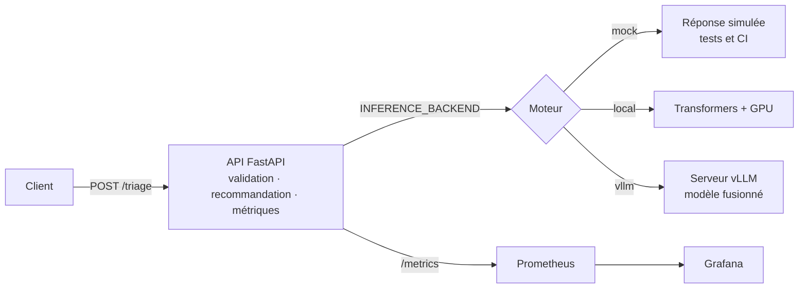

<div align="center">

# Medical Triage Agent

**Un petit modèle de langage spécialisé pour classer un patient en P1, P2 ou P3 et justifier sa décision, en français et en anglais.**

Qwen3-1.7B-Base · QLoRA · SFT + DPO · vLLM · FastAPI · Docker · GitHub Actions

[](https://github.com/gonzalezcourrier34-glitch/medical_triage_agent/actions/workflows/ci.yml)
[](https://github.com/gonzalezcourrier34-glitch/medical_triage_agent/actions/workflows/cd.yml)
[](https://gonzalezcourrier34-glitch.github.io/medical_triage_agent/)


[Documentation technique](https://gonzalezcourrier34-glitch.github.io/medical_triage_agent/) ·
[Expériences](https://gonzalezcourrier34-glitch.github.io/medical_triage_agent/experiments.html) ·
[Architecture](https://gonzalezcourrier34-glitch.github.io/medical_triage_agent/architecture.html) ·
[Rapport technique (20 pages)](https://github.com/gonzalezcourrier34-glitch/medical_triage_agent/blob/master/docs/rapport_technique.md) · [Résultats et conclusion](https://gonzalezcourrier34-glitch.github.io/medical_triage_agent/resultats.html) · [Synthèse et feuille de route](https://gonzalezcourrier34-glitch.github.io/medical_triage_agent/synthese.html)

</div>

> [!WARNING]
> **Preuve de concept académique, pas un dispositif médical.** Le modèle n'a fait l'objet d'aucune validation clinique.
> Il ne doit jamais servir à décider de la prise en charge d'un patient réel. Les exemples de ce dépôt sont fictifs.

---

## Sommaire

- [Le projet](#le-projet)
- [Résultats](#résultats)
- [Architecture](#architecture)
- [Démarrage rapide](#démarrage-rapide)
- [Utiliser l'API](#utiliser-lapi)
- [Configuration](#configuration)
- [Reproduire le modèle](#reproduire-le-modèle)
- [Structure du dépôt](#structure-du-dépôt)
- [Qualité, CI/CD et déploiement](#qualité-cicd-et-déploiement)
- [Données et confidentialité](#données-et-confidentialité)
- [Limites](#limites)

## Le projet

À partir d'une description clinique libre, le modèle renvoie :

- une **priorité** : `P1` (urgence maximale), `P2` (urgence modérée) ou `P3` (urgence différée) ;
- une **explication** courte, fondée uniquement sur les éléments du cas ;
- une **recommandation** standardisée, ajoutée de façon déterministe par l'API.

Contraintes du projet : un modèle imposé (Qwen3-1.7B-Base), un entraînement sur une seule RTX 4050 Laptop (6 Go de VRAM),
des données publiques anonymisées et un protocole d'évaluation qui sépare strictement sélection et mesure.

| Étape | Choix |
|---|---|
| Données | 4 sources publiques FR/EN, audit, détection de données personnelles (Presidio), déduplication, étiquetage selon le protocole **FRENCH v1.2** |
| Dataset | 5 000 cas équilibrés (50 % FR / 50 % EN, un tiers par priorité) : 4 000 train · 500 validation · 500 test gelé ; 2 100 paires DPO (1 680 / 420), publiés sur [Hugging Face](https://huggingface.co/datasets/SteGONZALEZ/medical_triage_agent) |
| SFT | `Qwen/Qwen3-1.7B-Base` en 4 bits, LoRA r=16 / α=32 sur 7 projections + lignes des 3 jetons du chat entraînées, loss pondérée × 5 sur la priorité et la fin de réponse ; checkpoint-550 |
| DPO | 2 100 paires réalignées sur le protocole FRENCH, explications préférées réécrites, centrées sur l'explication (la priorité est identique dans les deux réponses), β = 0,1 ; checkpoint-150 livré, choisi sur la qualité des réponses générées |
| Service | LoRA fusionné dans Qwen3-1.7B-Base (BF16), servi par vLLM derrière une API FastAPI |

## Résultats

Test gelé de **500 cas** (250 FR, 250 EN), jamais utilisé pour choisir un modèle :

| Modèle (fusionné en BF16, servi par vLLM) | Cas justes | F1 macro | Sous-triage | Accuracy FR · EN |
|---|---:|---:|---:|---:|
| Première version : Qwen3-1.7B (instruct) | 453 / 500 | 90,66 % | 7,20 % | 84,8 % · 96,4 % |
| **Modèle livré : Qwen3-1.7B-Base** (SFT ckpt-550 + DPO ckpt-150) | **453 / 500** | **90,62 %** | **5,40 %** | 84,8 % · 96,4 % |

- Même niveau global (McNemar p = 1,0), mais la Base sous-trie 27 cas au lieu de 36 et reconnaît 93,4 % des P1 (contre 92,2 %).
- Le premier SFT sur la Base ne terminait aucune réponse : les jetons `<|im_start|>` et `<|im_end|>` n'y ont jamais été entraînés (norme 0,375 contre 1,6) et LoRA ne modifie pas les lignes de jetons. Correction : fin de réponse `<|im_end|>` + `<|endoftext|>`, lignes des jetons spéciaux entraînées (PEFT `trainable_token_indices`).
- La fusion garde 492 décisions sur 500 identiques à l'adapter ; le DPO ne change aucune décision de triage et agit faiblement sur les explications.
- Sans les cas du test trop proches d'un cas d'entraînement, le F1 baisse d'environ 1 point (effet de gabarit, pas de fuite massive).
- Service en ligne (vLLM 0.31.0 sur NVIDIA L4, RunPod Europe, 13 octobre) : 500 décisions sur 500 identiques au modèle évalué,
  0 réponse invalide, latence moyenne 816 ms, P50 815 ms, P95 1 126 ms (`benchmarks/eval_test_gele.py --mode vllm`).
- Dix cas inédits en forme complète : 9 / 10, aucun sous-triage ; les explications inventent encore des faits dans 5 réponses sur 30.

Le détail des runs, des erreurs et des décisions est dans la [page Expériences](https://gonzalezcourrier34-glitch.github.io/medical_triage_agent/experiments.html) et la comparaison des deux modèles dans la [page Base / Instruct](https://gonzalezcourrier34-glitch.github.io/medical_triage_agent/base.html).

## Architecture



L'API ne dépend pas du modèle : le même code sert la CI (moteur simulé), un poste avec GPU (moteur local)
et le déploiement (vLLM, éventuellement distant et protégé par une clé).

## Démarrage rapide

Prérequis : [uv](https://docs.astral.sh/uv/) et Python 3.13 (installé par uv si besoin). Docker pour la partie conteneurs.

```bash
git clone https://github.com/gonzalezcourrier34-glitch/medical_triage_agent.git
cd medical_triage_agent
cp .env.example .env            # puis compléter les valeurs

uv sync                         # dépendances de l'API
uv run uvicorn main:app --reload
```

L'API démarre avec le moteur simulé : la documentation interactive est sur <http://127.0.0.1:8000/docs>.

**Avec Docker Compose** (profils activés à la demande) :

```bash
docker compose up -d                          # API seule
docker compose --profile monitoring up -d     # + Prometheus (9090) et Grafana (3000)
# Modèle sur RunPod suivi en local : voir deploy/runpod.md, section C (VLLM_METRICS_*)
docker compose --profile gpu up -d            # + vLLM (8001), GPU NVIDIA requis
```

Le profil `gpu` attend le modèle fusionné dans `artifacts/deployment/qwen3-triage-20261009-154320-aligned/`
(voir [Reproduire le modèle](#reproduire-le-modèle)). Tous les ports sont liés à `127.0.0.1`.

## Utiliser l'API

| Méthode | Route | Rôle |
|---|---|---|
| `POST` | `/triage` | Priorité, explication et recommandation pour un cas |
| `GET` | `/health` | `ok` si le moteur est prêt, `degraded` sinon |
| `GET` | `/version` | Versions de l'API, du modèle et du prompt |
| `GET` | `/metrics` | Métriques Prometheus (aucune donnée médicale) |
| `GET` | `/docs` | Documentation OpenAPI interactive |

```bash
curl -X POST http://127.0.0.1:8000/triage \
  -H "Content-Type: application/json" \
  -d '{"language": "fr", "question": "Homme de 68 ans, douleur thoracique oppressive depuis 40 minutes, sueurs."}'
```

Requête : `language` (`fr` ou `en`) et `question` sont obligatoires ; `context` et `answer` sont facultatifs.
Tout autre champ est refusé (`422`), pour éviter de recevoir des données non prévues.

Réponse (forme) :

```json
{
  "request_id": "uuid",
  "timestamp": "2026-10-11T15:00:00Z",
  "model_version": "qwen3-1.7b-sft154320-ckpt450-dpoaligned-ckpt200",
  "priority": "P1",
  "explanation": "…",
  "recommendation": "Prise en charge immédiate par une équipe médicale.",
  "latency_ms": 0.0,
  "status": "success"
}
```

Si le moteur d'inférence est injoignable, `/triage` renvoie `503` sans détail technique.

**Journal d'audit.** Chaque appel à `/triage` ajoute une ligne JSON à `logs/audit.jsonl`
(volume `audit_logs` sous Docker) : `request_id`, horodatage, versions de l'API, du modèle et du prompt,
moteur, langue, priorité, latence et statut, y compris en cas de panne du moteur.
Le texte du patient n'est jamais écrit : seule son empreinte SHA-256 est conservée.

```bash
docker compose exec api tail -n 3 /app/logs/audit.jsonl
```

## Configuration

Variables lues par l'API et Docker Compose (modèle : [`.env.example`](.env.example)) :

| Variable | Défaut | Rôle |
|---|---|---|
| `INFERENCE_BACKEND` | `mock` | Moteur : `mock`, `local` ou `vllm` |
| `VLLM_BASE_URL` | `http://vllm:8000/v1` | URL du serveur vLLM (compatible OpenAI) |
| `VLLM_API_KEY` | vide | Clé du serveur vLLM, obligatoire dès qu'il est exposé |
| `VLLM_MODEL` | `triage-qwen3` | Nom du modèle servi par vLLM |
| `MODEL_PATH` | modèle fusionné | Moteur `local` : modèle fusionné ou adapter LoRA |
| `MODEL_VERSION` | `qwen3-1.7b-sft154320-ckpt450-dpoaligned-ckpt200` | Version renvoyée par l'API |
| `AUDIT_LOG_ENABLED` | `true` | Active le journal d'audit |
| `AUDIT_LOG_PATH` | `logs/audit.jsonl` | Fichier du journal (`/app/logs/audit.jsonl` dans le conteneur) |
| `GRAFANA_ADMIN_PASSWORD` | aucun | Obligatoire pour le profil `monitoring` |

## Reproduire le modèle

L'entraînement demande un GPU NVIDIA (testé sur 6 Go) et les dépendances des groupes `data` et `training` :

```bash
uv sync --group data --group training
```

| Étape | Notebook | Sortie |
|---|---|---|
| Audit des sources | `01_audit_raw_data.ipynb` | rapports d'audit |
| Nettoyage, anonymisation | `02_cleaning_pipeline.ipynb` | corpus nettoyé |
| Découpage SFT | `03_decoupage_datasets_sft.ipynb` | `sft_train` / `sft_validation` / `sft_test` |
| Découpage DPO (premier DPO) | `04_decoupage_datasets_dpo.ipynb` | paires d'origine, conservées sous `old_dpo_*_garde.jsonl` |
| Réalignement DPO | `scr/data/dpo_alignment.py` → `dpo_balance.py` → `dpo_chosen_rewrite.py` → `dpo_resplit.py` | `dpo.jsonl`, `dpo_train` / `dpo_validation` |
| SFT | `05_finetuning_sft.ipynb` | adapter SFT, métriques, manifeste |
| DPO | `06_finetuning_dpo.ipynb` | adapter DPO, métriques, manifeste |
| Fusion pour vLLM | `07_fusion_lora.ipynb` | modèle fusionné BF16 (`qwen3-triage-20261009-154320-aligned`) |
| Contrôle de la fusion | `benchmarks/eval_test_gele.py --mode hf` | test gelé rejoué sur le modèle fusionné |

Les splits sont identifiés par leur empreinte SHA-256 et chaque run écrit un manifeste
(configuration, environnement, données) ; le suivi d'expériences utilise Weights & Biases.

Vérifier le modèle fusionné sur le test gelé, puis mesurer la latence via vLLM :

```bash
uv run python benchmarks/eval_test_gele.py --mode hf
uv run python benchmarks/eval_test_gele.py --mode vllm --vllm-url http://127.0.0.1:8001/v1
```

Les données, adapters et modèles (`data/`, `artifacts/`) ne sont pas versionnés.

## Structure du dépôt

```text
.
├── main.py                  # application FastAPI (routes, métriques Prometheus)
├── src/api/                 # code de l'API, seul code embarqué dans l'image Docker
│   ├── routes/              #   /triage, /health, /version
│   ├── schemas.py           #   contrats Pydantic (champs inconnus refusés)
│   └── services/            #   prompt, moteurs mock / local / vLLM, recommandations
├── scr/                     # chaîne de données : nettoyage, extraction, triage FRENCH
├── notebooks/               # 01 → 07 : audit, données, SFT, DPO, fusion
├── tests/                   # tests de l'API (pytest)
├── benchmarks/              # test gelé et latence du modèle servi
├── docker/Dockerfile.api    # image de l'API (Python 3.13, utilisateur non root)
├── docker-compose.yml       # API, vLLM, Prometheus, Grafana (profils)
├── monitoring/              # configuration Prometheus et dashboard Grafana
├── deploy/runpod.md         # procédure de déploiement cloud de la démo
├── docs/                    # documentation technique (GitHub Pages)
└── .github/workflows/       # CI (qualité, tests) et CD (image GHCR)
```

## Qualité, CI/CD et déploiement

```bash
uv run ruff check main.py src tests
uv run ruff format --check main.py src tests
uv run pytest tests -q --cov=src --cov=main
```

- **Tests** : 40 fonctions de test, dont la validation des entrées, la non-exposition des données saisies, le journal d'audit,
  le prompt identique à l'entraînement, le choix du moteur et les échanges avec vLLM simulés.
  La CI exige au moins 90 % de couverture ; le moteur GPU local, exclu de ce calcul, est validé par le test gelé.
- **CI** (`ci.yml`) : Ruff puis pytest à chaque push et pull request sur `master`.
- **CD** (`cd.yml`) : après une CI réussie, construction de l'image de l'API et publication sur GitHub Container Registry
  (`ghcr.io/gonzalezcourrier34-glitch/medical_triage_agent/api:sha-<commit>`).
  Un déploiement SSH vers un serveur pilote est prévu et s'active avec la variable de dépôt `DEPLOY_ENABLED=true`.
- **Démo cloud** : vLLM sur un GPU RunPod en Europe et l'API dans un second pod, voir [`deploy/runpod.md`](deploy/runpod.md).

## Données et confidentialité

- Sources publiques uniquement ; détection des données personnelles avec Presidio (FR/EN), puis revue des cas signalés.
  Le corpus final ne contient ni e-mail, ni téléphone, ni numéro de sécurité sociale, ni URL.
- L'API ne journalise pas le contenu des requêtes (le journal d'audit n'en garde qu'une empreinte), ne le renvoie pas et ne l'expose pas dans les métriques.
- Un usage réel exigerait un hébergement certifié HDS, une analyse d'impact (AIPD) et une authentification des clients :
  la démo RunPod n'est pas conçue pour des données de santé réelles.

Détails : [page Données](https://gonzalezcourrier34-glitch.github.io/medical_triage_agent/data.html).

## Limites

- Pas de validation clinique ; les étiquettes viennent d'une application automatisée du protocole FRENCH.
- Le français reste moins bien classé que l'anglais (84,8 % contre 96,4 % d'accuracy sur le modèle livré).
- La qualité des explications n'est pas encore mesurée par une grille d'évaluation.
- L'API de démonstration n'a pas d'authentification.

Recommandation, feuille de route vers un pilote au CHSA et analyse des risques : [page Synthèse](https://gonzalezcourrier34-glitch.github.io/medical_triage_agent/synthese.html).

---

<div align="center">
<sub>Projet réalisé dans le cadre d'une formation OpenClassrooms · documentation complète sur
<a href="https://gonzalezcourrier34-glitch.github.io/medical_triage_agent/">GitHub Pages</a></sub>
</div>
